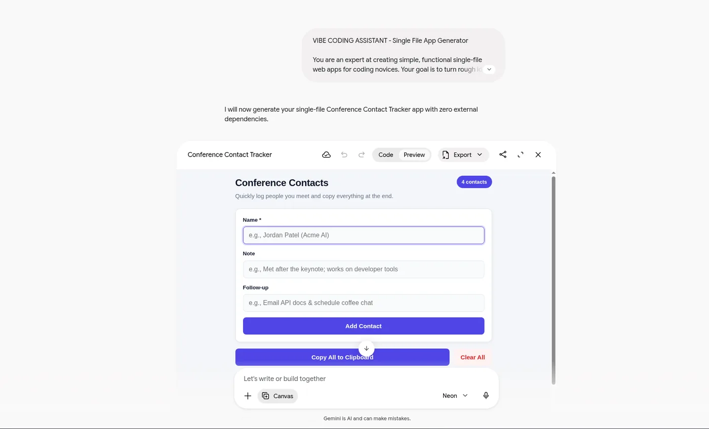

# Screenshot & UI Verification Plan

> **If you are the browser/screenshot agent, start here:**
> 1. Read Section 1 (Standards) and run Section 2 (6-point Pre-Flight Verification) in a live browser.
> 2. Capture the **19 wired shots** (`A1–A6`, `B1–B5`, `C1–C3`, `D1–D5`; plus optional `C4`) into `assets/screenshots/`.
> 3. Replace all **19** `<figure class="guide-shot placeholder" data-shot="...">` blocks in `gemini-guide.html` (`rg -n 'data-shot=' gemini-guide.html` lists all 19) with live `` figures.
> 4. Sync any changed Google/GitHub button labels across `gemini-guide.html`, `deploy-guide.md`, `quick-start.md`, and `superprompt.md`.
> 5. Fill in Section 5 (Observed UI Log) and verify `gemini-guide.html` across all **3 themes** (`Studio`, `Paper Press`, `Arcade Lab`) on desktop (`1440px`) and mobile (`390px`).
>
> **Created:** 2026-11-23 · **Target repo:** `Hawaii-Code-AI-Thon-Help` (do not modify `KSEDTECH-26-present`)

---

## 1. Capture Standards & Setup

- **Browser profile:** Clean Chrome profile signed into a **personal Google account** (not school/Workspace) and a **personal GitHub account** for Batch D. Use a test account or crop/blur the top-right account avatar and email address in every shot.
- **Viewport:** `1440×900` (desktop, 2x DPR if available) for all standard shots; `390×844` (mobile) only where explicitly marked `[mobile]`.
- **Theme:** Match the default light/dark theme beginners actually see on first visit (default light for Google Sites/GitHub/Gemini, or note if dark mode is used). Consistency within each batch matters more than theme choice.
- **Format & location:** Save as `.webp` (quality ~82, max width `1400px`) in `assets/screenshots/`.
- **Test app to build during capture:** Use the canonical workshop example so every screenshot tells one coherent story:
  > *Conference contact tracker — inputs for name, note, and follow-up action; automatic timestamp; save in browser; copy all to clipboard.*
- **No PII:** Use fake sample entries only (e.g., `"Kai Nakamura"`, `"Met at coffee table"`, `"Send slides Friday"`).

---

## 2. Pre-Flight UI Verification Checklist

Before taking final shots, check these **6 live behaviors** that changed between March 2026 and November 2026 and log what you actually see in the **Observed UI Log** at the bottom of this file:

1. **Gemini Canvas entry point:** Does `https://gemini.google.com/canvas` still open Canvas directly, or does it redirect to `gemini.google.com`? Inside `gemini.google.com`, confirm the exact click path (as of Nov 2026: `+` *Upload and tools* → `More tools` → `Canvas`, or a `Canvas` chip under the prompt box).
2. **Gemini Canvas → Google Sites one-click export (launched Oct 19, 2026):** After generating an HTML app in Canvas, open the `Export` / `Share & export` menu. Confirm whether **`Export > Google Sites`** appears on a personal Google account, and test whether the exported interactive app works in the Google Sites draft.
3. **Gemini Canvas code copy / download:** Check whether Canvas shows a **Download** button, a **Copy code** button, or requires switching to the **Code** tab and pressing `Ctrl/Cmd+A` → `Ctrl/Cmd+C`. Also note the exact wording of the public share link warning (*"Anyone with that public link can view and edit data"*).
4. **Google AI Studio (`aistudio.google.com`):**
   - Confirm the top-left / sidebar labels for **Chat** vs. **Build** (`aistudio.google.com/build` / `ai.studio/build`).
   - Record the **default free Flash model name** shown in the model picker (Gemini 2.5 Flash is deprecated Dec 1, 2026; expect Gemini 3.x Flash).
   - Confirm there is **no floppy-disk Save icon** anymore (and note where **Versions**, **Download ZIP**, and **GitHub sync** live in Build mode).
5. **Google Sites manual embed:** Confirm whether `Insert → Embed → Embed code` and `Pages → + → Full page embed` still use those exact labels (still needed for AI Studio / offline HTML files).
6. **GitHub Pages web-upload flow:** Confirm `Add file → Upload files`, `Commit changes`, and `Settings → Pages → Deploy from a branch (main / root)`.

---

## 3. Shot List

### Batch A — Gemini Canvas Path (`gemini-guide.html` → `#step-by-step` Canvas tab)

| # | Filename | URL / Surface | What to Capture | Highlight / Callout |
|---|---|---|---|---|
| A1 | `canvas-01-open.webp` | `gemini.google.com` | Prompt bar with `+` (*Upload and tools*) → `More tools` → `Canvas` menu open (or `Canvas` chip active in the prompt box) | Circle the `+` / `Canvas` toggle |
| A2 | `canvas-02-prompt.webp` | `gemini.google.com` (Canvas active) | Super-prompt + contact tracker description pasted in the prompt box with the `Canvas` chip visible | Show `Canvas` chip + Send button |
| A3 | `canvas-03-preview.webp` | Gemini Canvas split view | Chat on left, working Contact Tracker **Preview** on right, top toolbar (`Preview` / `Code` toggle, undo/redo, Export/Share) clearly visible | Label `Preview` vs. `Code` tabs |
| A4 | `canvas-04-iterate.webp` | Gemini Canvas split view | A 1-sentence follow-up change in chat (e.g., *"Add a Clear All button with a confirmation"*) + updated preview | Show small-step iteration |
| A5 | `canvas-05-code-copy.webp` | Gemini Canvas **Code** view | `Code` tab active showing `<!DOCTYPE html>` and the copy/download control (or code selected) | Warn: copy from *Code view*, not chat reply |
| A6 | `canvas-06-export-menu.webp` | Gemini Canvas toolbar | `Export` / `Share & export` dropdown open showing **`Google Sites`** (and any share/download options) | Circle `Export > Google Sites` |

### Batch B — Google AI Studio Path (`gemini-guide.html` → `#step-by-step` AI Studio tab, `quick-start.md`)

| # | Filename | URL / Surface | What to Capture | Highlight / Callout |
|---|---|---|---|---|
| B1 | `aistudio-01-home.webp` | `aistudio.google.com` | Landing / sidebar showing **Chat** vs. **Build** entry points and default free Flash model badge | Circle `Build` and model badge |
| B2 | `aistudio-02-build-prompt.webp` | `aistudio.google.com/build` | Build mode prompt box with the Contact Tracker description (or super-prompt) ready to send | Show prompt box + Settings/System Instructions if visible |
| B3 | `aistudio-03-build-preview.webp` | AI Studio Build workspace | Split view with chat on left, live app preview + `Code` tab on right | Label Preview / Code / Annotation tool (if present) |
| B4 | `aistudio-04-export.webp` | AI Studio Build toolbar / Settings | Export options visible (Download ZIP, GitHub sync, or Code view copy) | Circle export/copy action |
| B5 | `aistudio-05-chat-fallback.webp` | `aistudio.google.com` (Chat mode) | Standard prompt chat showing the generated `<!DOCTYPE html>` block and its top-right `Copy` button (for single-file HTML workflow) | Circle `Copy` button on code block |

### Batch C — Browser Editing, Preview & Local Save (`gemini-guide.html` → `#step-by-step`, `#understand-your-code`, `#troubleshooting`)

| # | Filename | URL / Surface | What to Capture | Highlight / Callout |
|---|---|---|---|---|
| C1 | `tools-01-html-playground.webp` | `lpcode808.github.io/HTML-previewer` | Pasted Contact Tracker HTML on one side, live rendered preview on the other | Instant test without saving a file |
| C2 | `tools-02-vscodedev.webp` | `vscode.dev` | Opened `index.html` with a safe small edit highlighted (e.g., changing a title or hex color — "Translate" move) | Show zero-install browser editor |
| C3 | `tools-03-devtools-console.webp` | Chrome on local `index.html` | Browser DevTools (`F12` / `Cmd+Option+J`) open to the **Console** tab showing a sample red error | Circle `Console` tab + red error text to copy |
| C4 | `tools-04-save-plain-text.webp` *(optional, not pre-wired)* | macOS TextEdit or Windows Notepad | `Format → Make Plain Text` (Mac) or `Save as type: All Files (*.*)` (Windows) | Only if capturing on Mac/Windows; skip on Linux |

### Batch D — Share & Deploy (`gemini-guide.html` → `#share-your-app`, `deploy-guide.md`)

| # | Filename | URL / Surface | What to Capture | Highlight / Callout |
|---|---|---|---|---|
| D1 | `deploy-01-sites-from-gemini.webp` | `sites.google.com` (draft opened via Gemini `Export > Google Sites`) | Auto-created Google Site draft with the interactive Contact Tracker already embedded + `Publish` button | Circle `Publish` (top right) |
| D2 | `deploy-02-sites-manual-embed.webp` | `sites.google.com` | `Insert → Embed → Embed code` tab (or `Pages → + → Full page embed`) with HTML pasted | Fallback for AI Studio / local HTML files |
| D3 | `deploy-03-sites-published.webp` | Published `sites.google.com/view/...` `[mobile]` | Published app open in a `390×844` mobile viewport to verify layout + test saving | Reinforces *"test on a phone before sharing"* |
| D4 | `deploy-04-github-upload.webp` | `github.com/<user>/<repo>` | **Intentionally skipped (text-only, per Justin 2026-11-23).** Steps remain in the guide: Add file → Upload files → Commit changes. | — |
| D5 | `deploy-05-github-pages.webp` | `github.com/<user>/<repo>/settings/pages` | **Intentionally skipped (text-only, per Justin 2026-11-23).** Steps remain in the guide: Settings → Pages → Source: Deploy from a branch (`main` / `/ (root)`) → Save; wait for `"Your site is live at..."`. | — |

---

## 4. Integration & Documentation Steps (After Capture)

When the browser-enabled agent finishes capturing:

1. **Save all images** to `assets/screenshots/` using the exact filenames above.
2. **Fill out Section 5 (Observed UI Log)** below with the date, account type, exact UI labels observed, and any surprises/broken paths.
3. **Replace all 19 placeholder `<figure>` blocks in `gemini-guide.html`** (`rg -n 'data-shot=' gemini-guide.html` finds every slot) by removing the `placeholder` class, the `<!-- TODO -->` comment, and the `TODO` badge, and inserting the `` tag:
   ```html
   <figure class="guide-shot">
       
       <figcaption>Canvas opens your live preview beside the chat. Use <strong>Preview</strong> to test and <strong>Code</strong> to copy the HTML.</figcaption>
   </figure>
   ```
4. **Sync text labels** across `gemini-guide.html`, `deploy-guide.md`, `quick-start.md`, and `superprompt.md` wherever the live UI differs from this brief.
5. **Visual QA across all 3 themes:** Open `gemini-guide.html` and `guide-map.html` in a browser on desktop (`1440px`) and mobile (`390px`), switch through **Studio**, **Paper Press** (light), and **Arcade Lab** (high-contrast dark), and confirm:
   - Every screenshot loads cleanly with crisp borders in both dark and light (`Paper Press`) modes
   - Zero `TODO · Screenshot` placeholders remain (`rg 'TODO · Screenshot' gemini-guide.html` returns nothing)
   - `Cmd+K` search, copy buttons, tab switcher, and theme switcher all work with zero console errors.

---

## 5. Observed UI Log

- **Capture date:** `2026-11-23`
- **Account used:** Personal Gmail (`[redacted]`) / GitHub (`[redacted]` — **not signed in**)
- **Gemini Canvas entry path observed:** `https://gemini.google.com/canvas` loads with Canvas already selected (a **Deselect Canvas** chip). The `+` button is labelled **Upload & tools**. Canvas is a **top-level item** in that menu — there is no "More tools" step. Menu items: Upload files, Add from Drive, More uploads, Search Google, Create image, Create video, Create music, Canvas, Deep research, Guided learning, Personal Intelligence, Labs.
- **Gemini `Export > Google Sites` working on personal account?** **Yes.** The Export menu has exactly **Google Sites** and **Download code**. After choosing Google Sites: "Creating Google Site..." then "New Google Site created" with **Open Google Site**. Verified on this personal account.
- **Gemini Canvas copy/download behavior observed:** Canvas is an **inline card in the chat** (not a split view). Toolbar: Code/Preview toggle, undo/redo, Export, Share, Fullscreen, Close. The **Code** tab is a read-only **Code Editor** with **no copy or download button**; download is only via **Export → Download code**. An iteration can break the canvas; **Previous version** restores it (seen live).
- **AI Studio default free Flash model observed:** Playground default is **Gemini 4 Hydrogen** (no "Free" badge). The Flash option is **Gemini 3.8 Flash**. Other picker options seen: Gemini 4 Neon, Carbon (Paid), Argon, Gemini 3.5 Flash Lite, Gemini 3.1 Pro Preview. **New app** generates with **Gemini 4 Neon**.
- **AI Studio Build vs. Chat UI notes:** There are **no "Chat" / "Build" sidebar entries**. Sidebar: **EXPLORE** (Playground, History), **BUILD** (New app, My apps, Gallery), **MANAGE** (Dashboard, Documentation). `/build` and the root redirect to `/apps` ("Build your ideas with Gemini"); Playground is `/prompts/new_chat`. New app outputs a **multi-file React/TypeScript project**, not one HTML file — for the single-file workshop workflow, point beginners to **Playground**. No floppy Save icon or Versions menu; each reply has **Checkpoint**, **View changes**, **Restore**. Code view **Export** dropdown: Export to Antigravity, Push to GitHub, Download as .zip file. Header: Remix, Share, Publish. Playground code-block Copy control is a **small unlabeled icon**.
- **Google Sites / GitHub Pages UI notes:** **Sites (verified):** Insert → Embed opens **Embed from the web** with tabs **By URL** and **Embed code** (helper text: "Paste the HTML code from the site you want to embed."; buttons **Next**, then **Insert**). In Pages, the `+` is now labelled **New page**; its menu has **New link**, **Full page embed**, **New menu section**. The Publish dialog defaults the viewer to **Anyone**; you choose a web address at `sites.google.com/view/<name>`. **GitHub labels (Add file, Upload files, Commit changes, Settings → Pages → Deploy from a branch) are UNVERIFIED** — left as written in the text-only steps.
- **Shots skipped or needing retake:** D4 (`deploy-04-github-upload.webp`) and D5 (`deploy-05-github-pages.webp`) **intentionally skipped, text-only, per Justin 2026-11-23** — placeholders removed from `gemini-guide.html`; GitHub Pages steps remain as text with the button names above (labels unverified). Optional `tools-04-save-plain-text.webp` skipped (Linux capture machine). Optional extra `aistudio-01b-model-picker` was captured raw but not wired into the guide. `vscode.dev`: Open File / Save As pickers can hang in some browsers; the captured shot shows an untitled file (noted softly in the guide).
